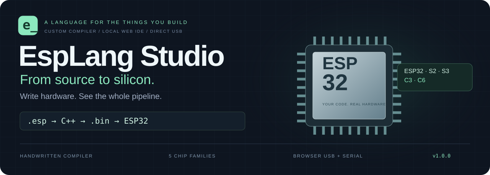
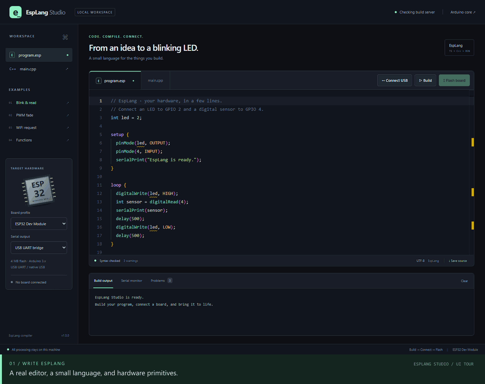
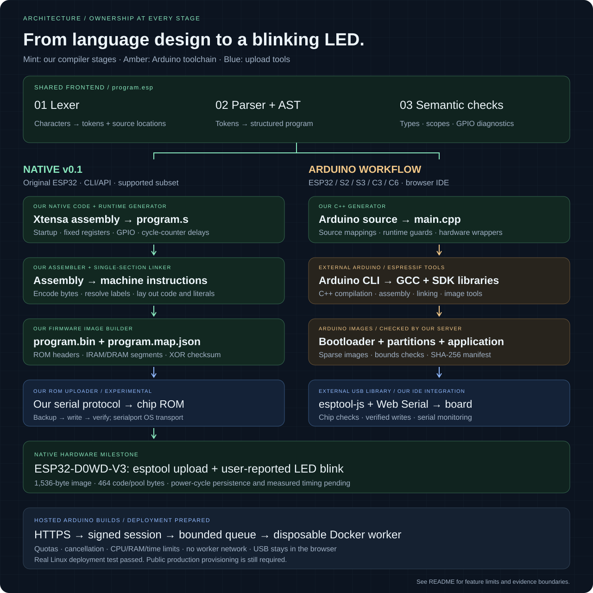

<div align="center">



# A small language. A complete hardware workflow.

Write **EspLang**, inspect the generated **C++**, build real **ESP32 firmware**, and flash your board directly from the browser.

[](https://github.com/TharunBabu-05/EspLang_Studio/actions/workflows/ci.yml)


[Quick start](#quick-start) · [Architecture](#architecture) · [Language guide](#language-guide) · [Supported boards](#supported-boards) · [Troubleshooting](#troubleshooting)

</div>

EspLang Studio is a local development environment built around a handwritten TypeScript compiler. Its lexer, parser, AST, semantic checker, and C++ generator turn `.esp` programs into Arduino-ESP32 source. A Node.js server invokes the native toolchain, streams build logs, and returns checked firmware images. The React IDE handles editing, diagnostics, downloads, browser USB flashing, and bidirectional serial monitoring.

**Source processing and firmware compilation run on your own machine.** The compiler and Monaco editor are bundled locally. GitHub hosts this repository, documentation, and media; the build server runs locally with Node.js and the ESP32 toolchain.

## See it in action



Recorded from the real application in an isolated browser session using the included examples. The tour demonstrates editor and compiler behavior plus board and serial controls. Actual flashing requires selecting a USB device in your browser.

[Open the full-size still screenshot](docs/assets/ide-overview.png) · [View the mobile layout](docs/assets/ide-mobile.png) · [See the recording script](scripts/record-readme-demo.mjs)

## What you can do

| Capability                       | Included behavior                                                                                                       |
| -------------------------------- | ----------------------------------------------------------------------------------------------------------------------- |
| **Write a hardware program**     | Typed variables, functions, `setup`, `loop` / `task`, conditions, loops, and hardware primitives                        |
| **Catch mistakes while editing** | Syntax and type errors, source positions, scope checks, GPIO validation, Monaco markers, and a navigable Problems panel |
| **Understand the translation**   | A read-only `main.cpp` tab shows generated C++ with source-line mappings                                                |
| **Build native firmware**        | Arduino CLI invokes Xtensa or RISC-V tools; live stdout/stderr arrive over WebSockets                                   |
| **Inspect the output**           | Download sparse binary images, generated C++, source files, and a firmware manifest                                     |
| **Flash from the browser**       | Chip-family and flash-capacity checks, compressed writes, MD5 verification, and reset via `esptool-js`                  |
| **Talk to your board**           | Bidirectional serial, selectable baud, and monitor disconnect/reconnect around flashing                                 |
| **Work locally**                 | Browser source autosave, bundled editor assets, and a workspace-local Windows toolchain installation                    |

## Quick start

### Requirements

- **Node.js 22.12 or newer**; the verified environment used Node 22.16.0.
- **Chrome or Edge** for Web Serial USB access, using localhost or HTTPS.
- **Several gigabytes of free disk space** for the ESP32 SDK, native tools, and download cache.
- A supported ESP32 board, a data-capable USB cable, and the appropriate USB driver for hardware use.

### Windows

```powershell
git clone https://github.com/TharunBabu-05/EspLang_Studio.git
cd EspLang_Studio
npm.cmd ci
npm.cmd run setup:toolchain
npm.cmd run dev
```

Open **http://127.0.0.1:5173**.

The setup script installs **Arduino CLI 1.3.1** and **Arduino-ESP32 3.3.2** into `.tools/`, along with workspace-local data, sketchbook, and cache paths. The first download can take several minutes; subsequent setup runs reuse installed packages. `npm.cmd` works in PowerShell environments that restrict `.ps1` launchers.

### Linux and macOS

Install [Arduino CLI](https://docs.arduino.cc/arduino-cli/installation/), then run:

```sh
git clone https://github.com/TharunBabu-05/EspLang_Studio.git
cd EspLang_Studio
npm ci
arduino-cli core update-index --additional-urls https://espressif.github.io/arduino-esp32/package_esp32_index.json
arduino-cli core install esp32:esp32@3.3.2 --additional-urls https://espressif.github.io/arduino-esp32/package_esp32_index.json
npm run dev
```

The server uses `.tools/arduino-cli` when present, or `arduino-cli` from `PATH`. You can select an existing installation through `ARDUINO_CLI` and `ARDUINO_CONFIG`; see [configuration](#configuration).

### Serve a production frontend build

```sh
npm run build
npm start
```

Open **http://127.0.0.1:3001**. Express serves the built IDE and the HTTP/WebSocket APIs from one origin. `start` runs the checked TypeScript server through the pinned `tsx` runtime. Compilation still needs the installed native toolchain.

## Architecture



The source follows this path:

```text
program.esp
  → lexer → tokens
  → recursive-descent parser → typed AST
  → semantic analysis → checked program
  → C++ generator → main.cpp
  → Node build server → Arduino CLI
  → Espressif GCC, assembler, linker, and image tools
  → bootloader + partition table + OTA metadata + application
  → browser esptool-js + Web Serial → ESP32
```

**The custom language front end and C++ generator are written from scratch in this repository.** The final machine-code backend comes from the existing Espressif/GCC toolchain. `.esp` is the file extension; the language is defined by its grammar, AST, types, and hardware semantics.

| Stage                             | Implementation                                                                                     | Responsibility                                                                      |
| --------------------------------- | -------------------------------------------------------------------------------------------------- | ----------------------------------------------------------------------------------- |
| Lexical analysis                  | [`lexer.ts`](packages/compiler/src/lexer.ts)                                                       | Tokenize identifiers, numbers, strings, comments, and operators; track source spans |
| Syntax and program representation | [`parser.ts`](packages/compiler/src/parser.ts), [`ast.ts`](packages/compiler/src/ast.ts)           | Parse statements and precedence rules into explicit AST nodes                       |
| Semantic analysis                 | [`analyzer.ts`](packages/compiler/src/analyzer.ts), [`boards.ts`](packages/compiler/src/boards.ts) | Check types, scopes, calls, returns, and board-specific GPIO constraints            |
| Source generation                 | [`codegen.ts`](packages/compiler/src/codegen.ts)                                                   | Emit C++, runtime hardware guards, and `#line` mappings                             |
| Build orchestration               | [`builder.ts`](packages/server/src/builder.ts)                                                     | Spawn the native tools, stream logs, package images, and validate layout            |
| Native code generation            | Arduino CLI + Arduino-ESP32 + Espressif GCC                                                        | Compile C++, link against the SDK, and create flashable images                      |
| USB transport                     | [`espFlasher.ts`](packages/web/src/espFlasher.ts) + `esptool-js`                                   | Detect the chip, check images, write flash, verify, and reset                       |

The same compiler package runs in the browser for immediate feedback and in the server before a native build. The server creates a minimal `.ino` file next to generated `main.cpp` so Arduino can build the project without applying sketch prototype generation to our generated C++.

## Your first program

Connect an LED with a suitable resistor to **GPIO 4**, then use:

```cpp
setup {
  pinMode(4, OUTPUT);
  serialPrint("Hello from EspLang");
}

loop {
  digitalWrite(4, HIGH);
  delay(500);
  digitalWrite(4, LOW);
  delay(500);
}
```

This is **EspLang syntax**; the code block uses C++ highlighting for readability on GitHub. Select an exposed GPIO appropriate to your actual board. An onboard LED is not always on GPIO 4.

1. Choose your **board profile** and **serial output** route.
2. Write code, or select an example. Open **Problems** to navigate diagnostics.
3. Inspect **main.cpp** if you want to see the translation.
4. Click **Build** and watch the live output. Successful builds expose image and manifest downloads.
5. Click **Connect USB**, choose your device, then **Flash board**.
6. Open **Serial monitor** at **115200 baud** to see generated firmware output.

Source is autosaved in browser storage. Editing source, changing the board, or changing the console route invalidates the previous firmware result and requires another build.

## Language guide

### Program structure and types

A program requires one `setup` block and one `loop` or `task` block. `setup` runs once; `loop` repeats. `task` is an alias for the repeating entry block and does not create a separate FreeRTOS task.

| Type     | Generated representation | Notes                                         |
| -------- | ------------------------ | --------------------------------------------- |
| `int`    | `int32_t`                | Signed 32-bit integer                         |
| `float`  | `double`                 | Double-precision floating-point value         |
| `bool`   | `bool`                   | `true` / `false`; conditions require booleans |
| `string` | Arduino `String`         | Double-quoted text                            |
| `void`   | `void`                   | Function return type                          |

Variables require initialization and use block scope. Global initializers must be constant expressions; hardware work belongs in entry blocks or functions. Integer-to-float promotion is accepted. Narrowing, implicit numeric-to-boolean conversion, and mixed string/number arithmetic are rejected.

### Functions and control flow

```cpp
fn twice(int value) -> int {
  return value * 2;
}

setup {
  pinMode(4, OUTPUT);
}

loop {
  for (int duty = 0; duty < 256; duty++) {
    pwmWrite(4, duty);
    delay(8);
  }

  int answer = twice(21);
  if (answer == 42) {
    serialPrint("The answer is 42");
  } else {
    serialPrint(answer);
  }
}
```

Forward function references and recursion are supported. Non-void functions must return on every checked path. Supported constructs include `if` / `else`, `while`, `for`, `return`, and nested blocks.

| Category       | Supported syntax                        |
| -------------- | --------------------------------------- |
| Arithmetic     | `+`, `-`, `*`, `/`, `%`, unary signs    |
| Comparison     | `==`, `!=`, `<`, `<=`, `>`, `>=`        |
| Logic          | `&&`, `                                 |     | `, `!` |
| Assignment     | `=`, `+=`, `-=`, `*=`, `/=`, `++`, `--` |
| Comments       | `// line` and `/* block */`             |
| String escapes | `\n`, `\r`, `\t`, `\"`, `\\`            |

Arithmetic follows the generated C++ behavior, including integer division and expression precedence. Function-argument evaluation order is unspecified. Avoid runtime integer overflow, computed division by zero, and unbounded recursion. Arrays, classes, user-defined structs, and interrupt declarations are outside the current language version.

### Hardware primitives

| Primitive      | Signature                                | Behavior                                                        |
| -------------- | ---------------------------------------- | --------------------------------------------------------------- |
| `pinMode`      | `(int pin, int mode) -> void`            | `INPUT`, `OUTPUT`, `INPUT_PULLUP`, or `INPUT_PULLDOWN`          |
| `digitalWrite` | `(int pin, int value) -> void`           | `HIGH` / `LOW`                                                  |
| `digitalRead`  | `(int pin) -> int`                       | Read a digital input                                            |
| `pwmWrite`     | `(int pin, int duty) -> void`            | Duty 0–255; 5 kHz, 8-bit LEDC; attach on first use              |
| `delay`        | `(int milliseconds) -> void`             | Nonnegative delay                                               |
| `serialPrint`  | `(int/float/bool/string value) -> void`  | Print a line                                                    |
| `wifiConnect`  | `(string ssid, string password) -> bool` | Connect in station mode; 15-second timeout                      |
| `httpGet`      | `(string url) -> string`                 | Plain HTTP; 5-second connection/read timeouts; bounded response |

Literal GPIOs are checked at compile time. Computed GPIOs are guarded at runtime. The profiles reject nonexistent and commonly reserved flash pins, restrict input-only pins, and warn about strapping, USB, UART, and module-dependent memory pins. They cannot infer your external wiring or every PSRAM configuration. Generated repeating loops yield for 1 ms per iteration. PWM uses a finite number of hardware channels; exhaustion produces a serial diagnostic.

### Networking

```cpp
setup {
  bool connected = wifiConnect("YOUR_SSID", "YOUR_PASSWORD");
  serialPrint(connected);
}

loop {
  string body = httpGet("http://example.com");
  serialPrint(body);
  delay(10000);
}
```

`httpGet` accepts successful 2xx responses with a known **Content-Length of at most 16,384 bytes**. Chunked responses, unknown lengths, oversized responses, and failed requests produce diagnostics and return an empty string. HTTPS is currently rejected; the runtime does not disable certificate verification to accept it.

WiFi credentials are compiled into the firmware. Use placeholders in committed source, screenshots, and issue reports. See [troubleshooting](#troubleshooting) for the Content-Length message visible with some HTTP endpoints.

### Generate C++ without installing the ESP32 toolchain

```sh
npx tsx scripts/compile.ts examples/blink.esp main.cpp esp32
```

This exercises the custom compiler only. Native `.bin` generation additionally requires Arduino CLI and the board core.

## Supported boards

The verified profiles use the default **4 MB** partition layout. They target generic development modules; check exposed pins and memory wiring on your specific module.

| Chip family | Architecture | Base Arduino FQBN     | Bootloader offset | Console options              |
| ----------- | ------------ | --------------------- | ----------------- | ---------------------------- |
| ESP32       | Xtensa       | `esp32:esp32:esp32`   | `0x1000`          | UART bridge                  |
| ESP32-S2    | Xtensa       | `esp32:esp32:esp32s2` | `0x1000`          | UART bridge / native USB CDC |
| ESP32-S3    | Xtensa       | `esp32:esp32:esp32s3` | `0x0000`          | UART bridge / native USB CDC |
| ESP32-C3    | RISC-V       | `esp32:esp32:esp32c3` | `0x0000`          | UART bridge / native USB CDC |
| ESP32-C6    | RISC-V       | `esp32:esp32:esp32c6` | `0x0000`          | UART bridge / native USB CDC |

**USB UART bridge** routes `Serial` through UART0 for boards using CP210x, CH340, or FTDI bridges. **Native USB CDC** adds the controlled `CDCOnBoot=cdc` board option for S2/S3/C3/C6. This changes the firmware's console route; the flashing transport is selected separately through the browser's port picker.

The USB vendor filters include `0x10C4`, `0x1A86`, `0x0403`, and Espressif `0x303A`. The flasher checks the actual chip family and requires at least 4 MB of detected flash before writing. Reset behavior depends on board wiring and USB mode. If a native USB device re-enumerates after reset, select the new port.

The monitor releases its reader/writer locks before flashing. If it was active, it reopens after a successful flash. Monitor baud choices are **115200** and **921600**; generated firmware starts at **115200**. Flash transfer uses 921600 independently.

## Firmware images and integrity

| Image            | ESP32 / S2 | S3 / C3 / C6 |
| ---------------- | ---------- | ------------ |
| `bootloader.bin` | `0x1000`   | `0x0000`     |
| `partitions.bin` | `0x8000`   | `0x8000`     |
| `boot_app0.bin`  | `0xE000`   | `0xE000`     |
| `firmware.bin`   | `0x10000`  | `0x10000`    |

The builder reads expanded platform properties, checks the bootloader offset against the selected profile, and checks application size against the actual partition table. It verifies sector alignment, image bounds, and non-overlap. The result includes Base64 images, byte counts, addresses, SHA-256 checksums, generated C++, diagnostics, the FQBN, and console routing.

The browser checks artifact integrity before writing. `esptool-js` performs compressed sparse writes with `eraseAll: false`, preserves the compiled flash parameters, verifies flash data using MD5, and requests a hard reset afterward. Flashing includes OTA metadata at `0xE000`; sectors covered by these images are erased.

The layout follows Espressif's [Arduino platform recipes](https://github.com/espressif/arduino-esp32/blob/3.3.2/platform.txt) and [board definitions](https://github.com/espressif/arduino-esp32/blob/3.3.2/boards.txt). Arbitrary FQBNs and custom partition tables are not accepted by the current server.

## Stack and repository map

| Area            | Direct technologies                                                                         |
| --------------- | ------------------------------------------------------------------------------------------- |
| Compiler        | TypeScript 5.9.3; handwritten lexer, recursive-descent parser, AST, analyzer, and generator |
| IDE             | React / React DOM 19.1.1; Monaco 0.52.2; `@monaco-editor/react` 4.7.0                       |
| Frontend build  | Vite 6.4.5; React plugin 4.7.0                                                              |
| Server          | Node.js; Express 5.1.0; `ws` 8.22.1; `tsx` 4.20.6                                           |
| USB and serial  | `esptool-js` 0.7.0; browser Web Serial; Node `serialport` 13.0.0 adapter                    |
| Integrity       | Node crypto / browser Web Crypto for SHA-256; CryptoJS 4.2.0 for MD5                        |
| Native firmware | Arduino CLI 1.3.1; Arduino-ESP32 3.3.2; Espressif Xtensa and RISC-V GCC tools               |
| Verification    | Vitest 4.1.12; Playwright 1.64.1; TypeScript checks                                         |
| Developer tools | npm workspaces; `concurrently` 9.2.5; Prettier 3.9.10                                       |
| README media    | Sharp 0.35.5; gifenc 1.0.3; Playwright capture; generated SVG                               |

TypeScript `@types/*` packages supply definitions for the browser and Node libraries. All direct versions are pinned; [`package-lock.json`](package-lock.json) records the resolved dependency graph.

```text
EspLang_Studio/
├── packages/
│   ├── compiler/src/
│   │   ├── lexer.ts, parser.ts, ast.ts
│   │   ├── analyzer.ts, boards.ts, codegen.ts
│   │   └── index.ts                 # Compiler API + shared protocol types
│   ├── server/src/
│   │   ├── server.ts                # HTTP, WebSocket, local access checks
│   │   ├── builder.ts               # Native builds and image packaging
│   │   └── nodeSerialAdapter.ts     # Adapter for Electron main-process use
│   └── web/src/
│       ├── IDE.tsx, language.ts     # Monaco and editor workflow
│       ├── espFlasher.ts, serialMonitor.ts
│       ├── ArtifactDownloads.tsx, examples.ts
│       └── main.tsx, style.css
├── examples/                       # Blink and network .esp programs
├── tests/                          # Compiler, build, USB, and stream tests
├── e2e/                            # Chrome IDE tests
├── scripts/                        # Setup, CLI, smoke tests, media generation
├── docs/assets/                    # Architecture SVG, banner, screenshots, GIF
├── .github/workflows/ci.yml         # Typecheck, test, and production build
├── README.md
└── VERIFICATION.md                 # Native build evidence and boundaries
```

`.tools/`, `.verification/`, `.builds/`, dependencies, generated bundles, environment files, and logs are excluded from Git. The Electron serial adapter is implemented; an Electron application shell and preload bridge are not included.

## Commands and verification

| Command                   | Purpose                                                                |
| ------------------------- | ---------------------------------------------------------------------- |
| `npm run setup:toolchain` | Install workspace-local Windows CLI and ESP32 SDK                      |
| `npm run dev`             | Run the server on 3001 and the IDE on 5173                             |
| `npm run typecheck`       | Check all three TypeScript packages                                    |
| `npm test`                | Run the 33 unit/integration tests                                      |
| `npm run build`           | Build the compiler, server, and production frontend                    |
| `npm start`               | Serve the production IDE and backend on 3001                           |
| `npm run test:smoke`      | Check HTTP and WebSocket paths against a running server                |
| `npm run test:firmware`   | Run a real native build through WebSocket; save checked images locally |
| `npm run test:browser`    | Run the three IDE browser tests                                        |
| `npm run docs:assets`     | Regenerate the SVG banner and architecture diagram                     |
| `npm run docs:record`     | Capture safe UI screenshots and regenerate the demo GIF                |

On Windows, use `npm.cmd` / `npx.cmd` if PowerShell blocks their script launchers. Browser tests use installed Chrome by default on Windows; override `CHROME_PATH` for another executable. To use Playwright Chromium on Linux/macOS, install it with `npx playwright install chromium --with-deps` and set `CHROME_PATH` to the installed executable for the test configuration, or use an installed Chrome executable.

The original verification run passed **33 tests**, **3 browser tests**, and production builds. Six native application builds passed through the live server:

| Program / target    | Application image bytes | Verified route |
| ------------------- | ----------------------: | -------------- |
| Blink / ESP32       |                 282,032 | UART           |
| Blink / ESP32-S2    |                 299,040 | Native USB CDC |
| Blink / ESP32-S3    |                 307,184 | Native USB CDC |
| Blink / ESP32-C3    |                 291,552 | Native USB CDC |
| Blink / ESP32-C6    |                 267,472 | Native USB CDC |
| WiFi + HTTP / ESP32 |                 934,640 | UART           |

See [`VERIFICATION.md`](VERIFICATION.md) for evidence, tool versions, saved artifact locations, and the limits of automated testing. Native builds verify SDK integration; hardware reset, flash readback, GPIO behavior, and networking need physical acceptance tests on your board. USB unit tests use a mock transport. The README GIF records actual UI interactions and does not record a hardware flash session.

GitHub Actions runs type checking, unit/integration tests, and production builds on pushes to `main` and on pull requests. Firmware builds and physical USB tests are separate from that workflow.

## Configuration

| Variable              | Default / role                                                                                 |
| --------------------- | ---------------------------------------------------------------------------------------------- |
| `HOST`                | `127.0.0.1`; backend bind address                                                              |
| `PORT`                | `3001`; backend port                                                                           |
| `ARDUINO_CLI`         | Override the native executable path                                                            |
| `ARDUINO_CONFIG`      | Override the Arduino CLI configuration path                                                    |
| `BUILD_TOKEN`         | Optional fixed session token; otherwise generated on startup                                   |
| `ALLOWED_ORIGINS`     | Comma-separated exact origins; defaults cover localhost/127.0.0.1 on 5173 and the backend port |
| `SMOKE_URL`           | `http://127.0.0.1:5173`; smoke-test server origin                                              |
| `SMOKE_BOARD`         | `esp32`; firmware smoke-test target                                                            |
| `SMOKE_SERIAL_ROUTE`  | `uart`; choose `usb` for a supported native CDC target                                         |
| `SMOKE_SOURCE`        | `examples/blink.esp`; source used by the native smoke build                                    |
| `SMOKE_OUTPUT`        | `.verification/<target>`; saved image directory                                                |
| `CHROME_PATH`         | Override the browser executable for browser tests/media capture                                |
| `PLAYWRIGHT_BASE_URL` | `http://127.0.0.1:5173`; use port 3001 to test production assets                               |
| `README_DEMO_URL`     | `http://127.0.0.1:5173`; application captured by the README recorder                           |

Set environment variables before starting the process; the server does not load a `.env` file automatically. The development frontend proxy targets port 3001 in [`vite.config.ts`](packages/web/vite.config.ts); update that proxy if you change the backend port.

The server is intended for a **local trusted-user workspace**. It includes origin/host checks, a session token, payload/log/time limits, a single active native build, process-tree cancellation, and temporary build cleanup. A public multi-user build service additionally needs authentication, tenant isolation, resource controls, and OS-level build sandboxing.

## API overview

| Endpoint            | Contract                                                                                       |
| ------------------- | ---------------------------------------------------------------------------------------------- |
| `GET /api/health`   | Server and native-toolchain readiness                                                          |
| `GET /api/session`  | Session token for WebSocket build requests                                                     |
| `POST /api/analyze` | JSON `{ "source": "...", "board": "esp32" }`; returns diagnostics and generated C++ when valid |
| `WS /api/build`     | Send one authenticated build request; receive logs, firmware, or an error                      |

Build request:

```json
{
  "token": "TOKEN_FROM_API_SESSION",
  "source": "setup {} loop { delay(1000); }",
  "board": "esp32",
  "serialRoute": "uart"
}
```

Events are typed in [`packages/compiler/src/index.ts`](packages/compiler/src/index.ts):

```text
log     → { type, message }
result  → { type, firmware: { board, serialRoute, fqbn, artifacts, cpp, diagnostics } }
error   → { type, message, diagnostics? }
```

Each artifact has `name`, `address`, `size`, Base64 `data`, and `sha256`. Diagnostics carry severity, message, and start/end source positions. The server accepts source up to its configured 100,000-character limit within the 128 KB request/message limit. Closing a build connection cancels its native process tree.

## Troubleshooting

| Symptom                                             | What to check                                                                                                                                                                              |
| --------------------------------------------------- | ------------------------------------------------------------------------------------------------------------------------------------------------------------------------------------------ |
| **ESP32 toolchain needs setup**                     | Run `npm.cmd run setup:toolchain` on Windows, or install Arduino CLI and `esp32:esp32@3.3.2` with the commands above. Check `ARDUINO_CLI` / `ARDUINO_CONFIG` if using an existing install. |
| **Large SDK download times out**                    | Rerun setup; completed archives are reused. The installer configures an extended network timeout for large toolchain packages.                                                             |
| **Build server offline**                            | Start `npm run dev`, check port 3001, and inspect the server terminal. A frontend-only static server cannot invoke the native compiler.                                                    |
| **GPIO is input-only or reserved**                  | Select a valid exposed pin for the selected board; input-only pins cannot drive outputs or use configurable pulls through this runtime.                                                    |
| **No port appears / USB unavailable**               | Use Chrome or Edge on localhost/HTTPS, check your USB cable and driver, and close other programs holding the port.                                                                         |
| **Connected chip differs from firmware**            | Select the matching board and rebuild before flashing.                                                                                                                                     |
| **ROM bootloader connection fails**                 | Verify DTR/RTS reset wiring and your board's USB mode. Boards without automatic boot wiring may need BOOT/EN buttons.                                                                      |
| **No serial output / garbled text**                 | Use 115200 baud for generated firmware and choose the correct UART/native CDC console route before building.                                                                               |
| **Native USB disappears after reset**               | Wait for re-enumeration, then choose the new port.                                                                                                                                         |
| **HTTP response must have Content-Length <= 16384** | The endpoint returned an unknown/chunked length or a body over 16 KB. Use a small plain-HTTP response with a known Content-Length.                                                         |
| **HTTPS request returns an empty string**           | HTTPS is outside the current `httpGet` runtime; a serial diagnostic explains the rejected URL.                                                                                             |
| **Origin is not allowed**                           | Use a supported local origin or set `ALLOWED_ORIGINS` explicitly for your trusted setup.                                                                                                   |

## Regenerate the README visuals

The artwork is maintained as code. The architecture is a real SVG; the animated demo is a GIF assembled from real browser screenshots using Sharp and gifenc.

```sh
npm run docs:assets
# Start the IDE in a separate terminal before the recording:
npm run dev
```

In another terminal:

```sh
npm run docs:record
```

The recorder opens a fresh browser context, uses safe examples, and closes only its own browser session. It does not request USB access, read an existing browser profile, or reuse your saved source. Generated media and metadata live in [`docs/assets`](docs/assets); debugging captures stay under ignored `.verification/`.

## Contributing

Changes to the language belong in `packages/compiler`; build and protocol work belongs in `packages/server`; editor and USB behavior belongs in `packages/web`.

Before opening a pull request, run:

```sh
npm run typecheck
npm test
npm run build
```

Add focused tests when changing grammar, semantics, hardware rules, or process/stream ownership. For UI changes, run browser tests against the running app. For board or SDK changes, run a native firmware smoke build and record the target, console route, and image layout. Keep credentials and generated toolchains out of commits.

## Built with

EspLang Studio builds on [Arduino-ESP32](https://github.com/espressif/arduino-esp32), [Arduino CLI](https://github.com/arduino/arduino-cli), [Espressif esptool-js](https://github.com/espressif/esptool-js), [Monaco Editor](https://github.com/microsoft/monaco-editor), [React](https://react.dev/), [Vite](https://vite.dev/), and their dependencies. The custom language compiler and application integration are maintained in this repository.

<div align="center">

**Write a little code. Make something happen.**

[Back to top](#a-small-language-a-complete-hardware-workflow)

</div>
