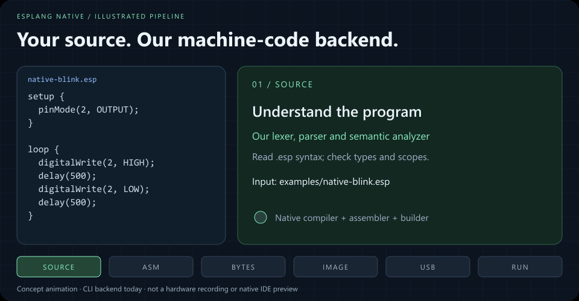

<div align="center">


# A small language. A complete hardware workflow.

Compile **`.esp → .bin`** with **our own native compiler, assembler, linker and firmware builder** for ESP32.

**Native pipeline:** `.esp → our compiler → Xtensa assembly → our assembler/linker → our image builder → .bin`

[](https://github.com/TharunBabu-05/EspLang_Studio/actions/workflows/ci.yml)


[Native build](#native-compiler-and-builder) · [Flash and recovery](#identify-back-up-and-flash) · [IDE setup](#quick-start) · [Architecture](#architecture) · [Language guide](#language-guide) · [Verification](#commands-and-verification)

</div>

EspLang Native compiles `.esp` directly into ESP32 `.bin` firmware through **our own compiler, Xtensa assembler, linker and image builder**. The native build has no C++ conversion stage. Its supported subset runs on the original ESP32 / ESP32-WROOM-32.

## Native compiler and builder

**This path goes directly from EspLang to machine instructions. It does not generate C++ or invoke Arduino CLI, GCC, LLVM, an external assembler/linker, or esptool during the build.** The compiler runs on Node.js and uses our handwritten TypeScript implementation. Uploading is a separate operation and currently uses external esptool.

From a fresh checkout, install Node.js 22.12+ and the project dependencies:

```powershell
git clone https://github.com/TharunBabu-05/EspLang_Studio.git
cd EspLang_Studio
npm.cmd ci
npm.cmd run build:native -- examples/native-blink.esp
```

On Linux/macOS use `npm` instead of `npm.cmd`. The native build does **not** require `setup:toolchain`. The example is:

```text
setup {
  pinMode(2, OUTPUT);
}

loop {
  digitalWrite(2, HIGH);
  delay(500);
  digitalWrite(2, LOW);
  delay(500);
}
```

| Output in `.builds/native/native-blink/` | Purpose                                                                           |
| ---------------------------------------- | --------------------------------------------------------------------------------- |
| `program.s`                              | Generated Xtensa assembly, literal pool and source-line annotations               |
| `program.code.bin`                       | Linked instructions/constants; not a standalone flash image                       |
| `program.bin`                            | Complete ROM-loadable image: **1,536 bytes**, including **464 code/pool bytes**   |
| `program.map.json`                       | Entry point, memory regions, symbols, variable addresses, assumptions and SHA-256 |

Our native builder uses a two-pass assembler with label resolution, a fixed memory layout, generated startup code and an image writer. Startup establishes the stack/data base, stalls the second core, handles boot watchdogs and selects the 40 MHz crystal. GPIO and cycle-counter delays use hardware registers directly. No Arduino library or prebuilt second-stage bootloader is linked into this image; the chip's built-in ROM still loads it.

<details>
<summary><strong>Native v0.1 support and limits</strong></summary>

- **Supported:** `setup`, `loop`/`task`, `return`, `int`, `bool`, globals/locals, scopes, `+`, `-`, `*`, comparisons, boolean logic, `if`/`else`, `while`, and `for`.
- **Hardware:** constant `pinMode(2, OUTPUT)`, `digitalWrite(2, HIGH/LOW)`, and constant `delay(0..60000)`.
- **Explicit errors:** unsupported chips, user functions, division/remainder, float/string, serial, GPIO input, PWM, Wi-Fi and HTTP. There is no silent Arduino fallback.
- **Limits:** 64,000 source characters, 32 KiB code/literal pool and 256 variable/temporary slots. Integer arithmetic wraps to 32 bits.
- **Target assumptions:** original ESP32-WROOM-32, 40 MHz crystal, 4 MB flash, secure boot and flash encryption disabled. GPIO 2 must have an LED attached; board LED wiring varies.
- **Integration:** CLI/API available. The browser IDE's Build button still uses Arduino. General register allocation, optimizing IR and a general-purpose ELF linker are future work.

The older `examples/blink.esp` includes serial output and input GPIO. Use `examples/native-blink.esp` for this backend. Full implementation details: [NATIVE_COMPILER.md](docs/NATIVE_COMPILER.md).

</details>

## Identify, back up, and flash

These are three separate operations. **`read-flash` creates a backup; restoring it requires `write-flash`.** The assignments `$espTool = ...` and `$nativeBackup = ...` only set PowerShell variables.

| Command       | Purpose                                                         | Data direction        | Changes stored firmware? |
| ------------- | --------------------------------------------------------------- | --------------------- | ------------------------ |
| `flash-id`    | Identify the chip and flash; confirm compatibility              | Board → terminal      | No                       |
| `read-flash`  | Save the existing flash contents for recovery                   | Board → laptop `.bin` | No                       |
| `write-flash` | Erase affected sectors, install the new image, verify and reset | Laptop `.bin` → board | Yes                      |

The following PowerShell commands use the **esptool 5.1.0 executable already present in this project's Windows toolchain installation**. If it is absent, install esptool separately and substitute its executable, or use `python -m esptool` in place of `& $espTool`. Only uploading needs esptool; native compilation does not need the Arduino SDK. See [Espressif's command reference](https://docs.espressif.com/projects/esptool/en/latest/esp32/esptool/basic-commands.html).

### 1. Identify the connected board

Close the browser's USB connection and all serial monitors first. Replace **COM13** with the port shown in your Device Manager.

```powershell
$espTool = ".\.tools\data\packages\esp32\tools\esptool_py\5.1.0\esptool.exe"
$espPort = "COM13"
& $espTool --chip esp32 --port $espPort flash-id
```

For this native image, confirm **original ESP32**, **40 MHz crystal**, and **4 MB flash**. Stop if they differ. The tested board reported `ESP32-D0WD-V3 (revision v3.1)`.

### 2. Save a complete recovery backup

```powershell
New-Item -ItemType Directory -Force .\.builds | Out-Null
$nativeBackup = ".\.builds\esp32-backup-" + (Get-Date -Format "yyyyMMdd-HHmmss") + ".bin"
$nativeBackupVerified = $false
& $espTool --chip esp32 --port $espPort --baud 460800 read-flash 0x0 0x400000 $nativeBackup
if ($LASTEXITCODE -ne 0) { throw "Backup failed. Do not proceed to flashing." }
if ((Get-Item -LiteralPath $nativeBackup).Length -ne 4194304) { throw "Backup size is incomplete." }
$nativeBackupVerified = $true
```

Wait for **100% and successful completion**. Do not press RESET/EN during the read. Keep the backup private: flash may contain saved credentials or application data. `.builds/` is excluded from Git.

The first reported hardware session interrupted this read at **10.9%** by pressing RESET; esptool reported `Packet content transfer stopped`. That session did **not** produce a verified full recovery backup. Do not restore a partial backup. A fresh backup after flashing saves the current native firmware, not the previous full image.

### 3. Install our native image

Build `examples/native-blink.esp` first. In the same terminal, after a successful backup:

```powershell
if ($nativeBackupVerified -ne $true) { throw "Complete the backup step first." }
& $espTool --chip esp32 --port $espPort --baud 115200 --no-stub write-flash --flash-mode dio --flash-freq 40m --flash-size 4MB 0x1000 ".\.builds\native\native-blink\program.bin"
```

**This image replaces the usual bootloader at `0x1000`.** It is not an Arduino application for `0x10000`; do not pass it to the existing IDE's Arduino flashing manifest. The tool erases the affected sector automatically; a full `erase-flash` is unnecessary.

`--no-stub` uploads through the chip's built-in ROM without loading esptool's temporary RAM flasher. The identify/backup commands above use esptool's normal temporary stub; no stub is included in our generated firmware. `--baud` sets USB-UART transfer speed, while `--flash-freq 40m` sets SPI flash frequency.

Successful output includes `Hash of data verified` and `Hard resetting via RTS pin`. The native file is 1,536 bytes; the tool reported writing 2,048 transfer bytes in the recorded session because of transfer padding. After reset, the connected GPIO 2 LED should alternate approximately every half-second. This program does not print serial messages.

**RESET/EN restarts the processor; it does not erase firmware.** Pressing it during a transfer interrupts that transfer. If connection is stuck at `Connecting…`, hold BOOT, briefly press EN/RESET, then release BOOT once connected. Do not keep resetting during reading/writing. After a successful flash, unplug/reconnect power to separately check persistence.

<details>
<summary><strong>Restore a known-good complete backup</strong></summary>

In the same terminal, with the original successful backup still selected:

```powershell
if ($nativeBackupVerified -ne $true) { throw "Select a known-good complete backup before restoring." }
& $espTool --chip esp32 --port $espPort --baud 460800 write-flash 0x0 $nativeBackup
```

In a new terminal, reselect the tool, port and a backup whose successful read you verified. A full 4 MB file alone does not establish that its contents are correct. Never restore the interrupted backup from the first test. Restoring writes the saved bootloader, applications, partition data and settings back to flash.

</details>

## See it in action



Illustrated native pipeline, generated from code. This animation explains the stages; it is not a recording of hardware or an implemented native IDE interface. [Static architecture alternative](docs/assets/architecture.svg).


The second animation is a recording of the real browser IDE's **Arduino workflow**, using safe bundled examples. It demonstrates editing, compiler feedback and board/serial controls; it does not record a physical flash session.

[Open the full-size still screenshot](docs/assets/ide-overview.png) · [View the mobile layout](docs/assets/ide-mobile.png) · [See the recording script](scripts/record-readme-demo.mjs)

## What you can do

| Capability                        | Included behavior                                                                                                            |
| --------------------------------- | ---------------------------------------------------------------------------------------------------------------------------- |
| **Write a hardware program**      | Typed variables, functions, `setup`, `loop` / `task`, conditions, loops, and hardware primitives                             |
| **Catch mistakes while editing**  | Syntax and type errors, source positions, scope checks, GPIO validation, Monaco markers, and a navigable Problems panel      |
| **Understand the translation**    | A read-only `main.cpp` tab shows generated C++ with source-line mappings                                                     |
| **Build through Arduino**         | Arduino CLI invokes Xtensa or RISC-V tools; live stdout/stderr arrive over WebSockets                                        |
| **Build with our native backend** | Generate Xtensa instructions, resolve labels, lay out memory, and package an ESP32 ROM image entirely in our TypeScript code |
| **Inspect the output**            | Download sparse binary images, generated C++, source files, and a firmware manifest                                          |
| **Flash from the browser**        | Chip-family and flash-capacity checks, compressed writes, MD5 verification, and reset via `esptool-js`                       |
| **Talk to your board**            | Bidirectional serial, selectable baud, and monitor disconnect/reconnect around flashing                                      |
| **Work locally**                  | Browser source autosave, bundled editor assets, and a workspace-local Windows toolchain installation                         |
| **Prepare public hosting**        | HTTPS gateway, expiring sessions, per-address limits, bounded queue and isolated disposable build workers                    |

## Existing Arduino workflow and hosting

The repository also retains the earlier C++/Arduino backend for the browser IDE and its broader hardware/language support. This is a separate workflow; it is not a stage of our native build.

| Choose a workflow     | Arduino backend / browser IDE                                | EspLang Native v0.1 / CLI                                                    |
| --------------------- | ------------------------------------------------------------ | ---------------------------------------------------------------------------- |
| Compilation           | `.esp → C++ → Espressif toolchain → firmware`                | `.esp → Xtensa assembly → our assembler/linker → firmware`                   |
| Firmware dependencies | Arduino CLI, Arduino-ESP32 and its SDK/toolchain             | Our generated startup/runtime; no prebuilt firmware SDK libraries            |
| Targets               | ESP32, S2, S3, C3, C6                                        | Original ESP32 / ESP32-WROOM-32 only                                         |
| Language coverage     | Functions, strings, float, GPIO, serial, PWM, Wi-Fi and HTTP | Int/bool, arithmetic subset, control flow, GPIO 2 output and constant delays |
| Upload                | Browser `esptool-js` + Web Serial                            | Separate `esptool` CLI; native uploader not yet implemented                  |
| Entry point           | `npm run dev`, then the IDE Build button                     | `npm run build:native -- examples/native-blink.esp`                          |

**Hardware milestone — November 7, 2026:** native firmware was uploaded to an **ESP32-D0WD-V3, revision v3.1**, with a **40 MHz crystal and 4 MB flash**. The supplied terminal log confirms flash hash verification, and the user reported the LED blinking after upload/reset. Power-cycle persistence and measured timing have not yet been reported. See the [hardware evidence record](docs/NATIVE_COMPILER.md#hardware-test-record).

**Hosted mode is also implemented for the Arduino workflow:** HTTPS, signed sessions, a bounded queue, quotas, cancellation, and disposable Docker build workers. [Deployment instructions](docs/HOSTING.md) and a successful Linux deployment test are included. A public production URL has not been established; the Docker deployment still needs a server/domain. Managed Vercel deployment work is incomplete.

## Quick start

This section starts the **Arduino-backed browser IDE**. For the SDK-free native CLI build, use [Native compiler and builder](#native-compiler-and-builder).

### Requirements

- **Node.js 22.12 or newer**; the verified environment used Node 22.16.0.
- **Chrome or Edge** for Web Serial USB access, using localhost or HTTPS.
- **Several gigabytes of free disk space** for the ESP32 SDK, native tools, and download cache.
- A supported ESP32 board, a data-capable USB cable, and the appropriate USB driver for hardware use.

### Windows

```powershell
git clone https://github.com/TharunBabu-05/EspLang_Studio.git
cd EspLang_Studio
npm.cmd ci
npm.cmd run setup:toolchain
npm.cmd run dev
```

Open **http://127.0.0.1:5173**.

The setup script installs **Arduino CLI 1.3.1** and **Arduino-ESP32 3.3.2** into `.tools/`, along with workspace-local data, sketchbook, and cache paths. The first download can take several minutes; subsequent setup runs reuse installed packages. `npm.cmd` works in PowerShell environments that restrict `.ps1` launchers.

### Linux and macOS

Install [Arduino CLI](https://docs.arduino.cc/arduino-cli/installation/), then run:

```sh
git clone https://github.com/TharunBabu-05/EspLang_Studio.git
cd EspLang_Studio
npm ci
arduino-cli core update-index --additional-urls https://espressif.github.io/arduino-esp32/package_esp32_index.json
arduino-cli core install esp32:esp32@3.3.2 --additional-urls https://espressif.github.io/arduino-esp32/package_esp32_index.json
npm run dev
```

The server uses `.tools/arduino-cli` when present, or `arduino-cli` from `PATH`. You can select an existing installation through `ARDUINO_CLI` and `ARDUINO_CONFIG`; see [configuration](#configuration).

### Serve a production frontend build

```sh
npm run build
npm start
```

Open **http://127.0.0.1:3001**. Express serves the built IDE and the HTTP/WebSocket APIs from one origin. `start` runs the checked TypeScript server through the pinned `tsx` runtime. Compilation still needs the installed native toolchain.

## Architecture


Both backends start with our handwritten language frontend:

```text
program.esp
  → lexer → tokens
  → recursive-descent parser → AST
  → semantic analysis → checked program
       ├─ Native CLI: our Xtensa code generator → program.s
       │    → our assembler + single-section linker
       │    → our startup/runtime + image packager → program.bin
       │    → esptool ROM upload → original ESP32
       │
       └─ Browser IDE: our C++ generator → main.cpp
            → Node server → Arduino CLI + Espressif GCC/SDK
            → bootloader + partitions + OTA metadata + application
            → esptool-js + Web Serial → supported ESP32 family
```

**Our code now covers the language frontend, C++ generator, native Xtensa code generator, native assembler/linker, runtime generation and firmware packaging.** The Arduino workflow still delegates final machine-code generation to Espressif/GCC. Host runtimes and USB upload tools remain external dependencies; the native firmware contains no prebuilt SDK runtime.

| Stage                             | Implementation                                                                                           | Responsibility                                                                                 |
| --------------------------------- | -------------------------------------------------------------------------------------------------------- | ---------------------------------------------------------------------------------------------- |
| Lexical analysis                  | [`lexer.ts`](packages/compiler/src/lexer.ts)                                                             | Tokenize identifiers, numbers, strings, comments, and operators; track source spans            |
| Syntax and program representation | [`parser.ts`](packages/compiler/src/parser.ts), [`ast.ts`](packages/compiler/src/ast.ts)                 | Parse statements and precedence rules into explicit AST nodes                                  |
| Semantic analysis                 | [`analyzer.ts`](packages/compiler/src/analyzer.ts), [`boards.ts`](packages/compiler/src/boards.ts)       | Check types, scopes, calls, returns, and board-specific GPIO constraints                       |
| C++ source generation             | [`codegen.ts`](packages/compiler/src/codegen.ts)                                                         | Emit C++, Arduino runtime guards and source mappings                                           |
| Native code/runtime generation    | [`native/compiler.ts`](packages/compiler/src/native/compiler.ts)                                         | Lower supported source to Xtensa instructions; emit startup, GPIO and delay code               |
| Native assembler and linker       | [`native/assembler.ts`](packages/compiler/src/native/assembler.ts)                                       | Encode instructions, resolve labels/literals, reject invalid operands and branch ranges        |
| Native image builder              | [`native/image.ts`](packages/compiler/src/native/image.ts), [`native-build.ts`](scripts/native-build.ts) | Validate memory regions; write ROM image headers, segments, padding, checksum and output files |
| Arduino build orchestration       | [`builder.ts`](packages/server/src/builder.ts)                                                           | Spawn Arduino tools, stream logs and validate the returned image layout                        |
| Arduino machine-code backend      | Arduino CLI + Arduino-ESP32 + Espressif GCC                                                              | Compile generated C++, link SDK libraries and create flash images                              |
| USB transport                     | [`espFlasher.ts`](packages/web/src/espFlasher.ts) + `esptool-js`                                         | Detect the chip, check images, write flash, verify, and reset                                  |

The language frontend runs in the browser for immediate feedback and in the server before an Arduino build. The Arduino server creates a minimal `.ino` next to `main.cpp` to avoid sketch prototype generation on our C++. The native CLI uses `compileNative()` directly and needs no server or child compiler process. Hosted builds currently use the Arduino branch.

## Your first program

This example uses the **Arduino backend**. The native GPIO 2 example is [above](#native-compiler-and-builder).

Connect an LED with a suitable resistor to **GPIO 4**, then use:

```cpp
setup {
  pinMode(4, OUTPUT);
  serialPrint("Hello from EspLang");
}

loop {
  digitalWrite(4, HIGH);
  delay(500);
  digitalWrite(4, LOW);
  delay(500);
}
```

This is **EspLang syntax**; the code block uses C++ highlighting for readability on GitHub. Select an exposed GPIO appropriate to your actual board. An onboard LED is not always on GPIO 4.

1. Choose your **board profile** and **serial output** route.
2. Write code, or select an example. Open **Problems** to navigate diagnostics.
3. Inspect **main.cpp** if you want to see the translation.
4. Click **Build** and watch the live output. Successful builds expose image and manifest downloads.
5. Click **Connect USB**, choose your device, then **Flash board**.
6. Open **Serial monitor** at **115200 baud** to see generated firmware output.

Source is autosaved in browser storage. Editing source, changing the board, or changing the console route invalidates the previous firmware result and requires another build.

## Language guide

This section describes the full language through the **Arduino backend**. Native v0.1 implements the smaller [documented subset](docs/NATIVE_COMPILER.md#language-subset); unsupported features produce errors.

### Program structure and types

A program requires one `setup` block and one `loop` or `task` block. `setup` runs once; `loop` repeats. `task` is an alias for the repeating entry block and does not create a separate FreeRTOS task.

| Type     | Generated representation | Notes                                         |
| -------- | ------------------------ | --------------------------------------------- |
| `int`    | `int32_t`                | Signed 32-bit integer                         |
| `float`  | `double`                 | Double-precision floating-point value         |
| `bool`   | `bool`                   | `true` / `false`; conditions require booleans |
| `string` | Arduino `String`         | Double-quoted text                            |
| `void`   | `void`                   | Function return type                          |

Variables require initialization and use block scope. Global initializers must be constant expressions; hardware work belongs in entry blocks or functions. Integer-to-float promotion is accepted. Narrowing, implicit numeric-to-boolean conversion, and mixed string/number arithmetic are rejected.

### Functions and control flow

```cpp
fn twice(int value) -> int {
  return value * 2;
}

setup {
  pinMode(4, OUTPUT);
}

loop {
  for (int duty = 0; duty < 256; duty++) {
    pwmWrite(4, duty);
    delay(8);
  }

  int answer = twice(21);
  if (answer == 42) {
    serialPrint("The answer is 42");
  } else {
    serialPrint(answer);
  }
}
```

Forward function references and recursion are supported. Non-void functions must return on every checked path. Supported constructs include `if` / `else`, `while`, `for`, `return`, and nested blocks.

| Category       | Supported syntax                        |
| -------------- | --------------------------------------- |
| Arithmetic     | `+`, `-`, `*`, `/`, `%`, unary signs    |
| Comparison     | `==`, `!=`, `<`, `<=`, `>`, `>=`        |
| Logic          | `&&`, `\|\|`, `!`                       |
| Assignment     | `=`, `+=`, `-=`, `*=`, `/=`, `++`, `--` |
| Comments       | `// line` and `/* block */`             |
| String escapes | `\n`, `\r`, `\t`, `\"`, `\\`            |

Arithmetic follows the generated C++ behavior, including integer division and expression precedence. Function-argument evaluation order is unspecified. Avoid runtime integer overflow, computed division by zero, and unbounded recursion. Arrays, classes, user-defined structs, and interrupt declarations are outside the current language version.

### Hardware primitives

| Primitive      | Signature                                | Behavior                                                        |
| -------------- | ---------------------------------------- | --------------------------------------------------------------- |
| `pinMode`      | `(int pin, int mode) -> void`            | `INPUT`, `OUTPUT`, `INPUT_PULLUP`, or `INPUT_PULLDOWN`          |
| `digitalWrite` | `(int pin, int value) -> void`           | `HIGH` / `LOW`                                                  |
| `digitalRead`  | `(int pin) -> int`                       | Read a digital input                                            |
| `pwmWrite`     | `(int pin, int duty) -> void`            | Duty 0–255; 5 kHz, 8-bit LEDC; attach on first use              |
| `delay`        | `(int milliseconds) -> void`             | Nonnegative delay                                               |
| `serialPrint`  | `(int/float/bool/string value) -> void`  | Print a line                                                    |
| `wifiConnect`  | `(string ssid, string password) -> bool` | Connect in station mode; 15-second timeout                      |
| `httpGet`      | `(string url) -> string`                 | Plain HTTP; 5-second connection/read timeouts; bounded response |

Literal GPIOs are checked at compile time. Computed GPIOs are guarded at runtime. The profiles reject nonexistent and commonly reserved flash pins, restrict input-only pins, and warn about strapping, USB, UART, and module-dependent memory pins. They cannot infer your external wiring or every PSRAM configuration. Generated repeating loops yield for 1 ms per iteration. PWM uses a finite number of hardware channels; exhaustion produces a serial diagnostic.

### Networking

```cpp
setup {
  bool connected = wifiConnect("YOUR_SSID", "YOUR_PASSWORD");
  serialPrint(connected);
}

loop {
  string body = httpGet("http://example.com");
  serialPrint(body);
  delay(10000);
}
```

`httpGet` accepts successful 2xx responses with a known **Content-Length of at most 16,384 bytes**. Chunked responses, unknown lengths, oversized responses, and failed requests produce diagnostics and return an empty string. HTTPS is currently rejected; the runtime does not disable certificate verification to accept it.

WiFi credentials are compiled into the firmware. Use placeholders in committed source, screenshots, and issue reports. See [troubleshooting](#troubleshooting) for the Content-Length message visible with some HTTP endpoints.

### Generate C++ without installing the ESP32 toolchain

```sh
npx tsx scripts/compile.ts examples/blink.esp main.cpp esp32
```

This exercises the C++ backend only. Arduino firmware generation needs Arduino CLI and the board core. Our separate `build:native` command generates a `.bin` without those dependencies for its supported subset.

## Supported boards

The following **Arduino profiles** use the default **4 MB** partition layout. Our native backend supports only the original ESP32 and uses a single ROM image instead of this partitioned application layout. Check exposed pins and wiring on your module.

| Chip family | Architecture | Base Arduino FQBN     | Bootloader offset | Console options              |
| ----------- | ------------ | --------------------- | ----------------- | ---------------------------- |
| ESP32       | Xtensa       | `esp32:esp32:esp32`   | `0x1000`          | UART bridge                  |
| ESP32-S2    | Xtensa       | `esp32:esp32:esp32s2` | `0x1000`          | UART bridge / native USB CDC |
| ESP32-S3    | Xtensa       | `esp32:esp32:esp32s3` | `0x0000`          | UART bridge / native USB CDC |
| ESP32-C3    | RISC-V       | `esp32:esp32:esp32c3` | `0x0000`          | UART bridge / native USB CDC |
| ESP32-C6    | RISC-V       | `esp32:esp32:esp32c6` | `0x0000`          | UART bridge / native USB CDC |

**USB UART bridge** routes `Serial` through UART0 for boards using CP210x, CH340, or FTDI bridges. **Native USB CDC** adds the controlled `CDCOnBoot=cdc` board option for S2/S3/C3/C6. This changes the firmware's console route; the flashing transport is selected separately through the browser's port picker.

The USB vendor filters include `0x10C4`, `0x1A86`, `0x0403`, and Espressif `0x303A`. The flasher checks the actual chip family and requires at least 4 MB of detected flash before writing. Reset behavior depends on board wiring and USB mode. If a native USB device re-enumerates after reset, select the new port.

The monitor releases its reader/writer locks before flashing. If it was active, it reopens after a successful flash. Monitor baud choices are **115200** and **921600**; generated firmware starts at **115200**. Flash transfer uses 921600 independently.

## Firmware images and integrity

The table below applies to the **Arduino workflow**. Native v0.1 emits one `program.bin` at `0x1000`, containing IRAM code/literals and zero-initialized DRAM; see [native memory layout](docs/NATIVE_COMPILER.md#runtime-and-memory-layout).

| Image            | ESP32 / S2 | S3 / C3 / C6 |
| ---------------- | ---------- | ------------ |
| `bootloader.bin` | `0x1000`   | `0x0000`     |
| `partitions.bin` | `0x8000`   | `0x8000`     |
| `boot_app0.bin`  | `0xE000`   | `0xE000`     |
| `firmware.bin`   | `0x10000`  | `0x10000`    |

The builder reads expanded platform properties, checks the bootloader offset against the selected profile, and checks application size against the actual partition table. It verifies sector alignment, image bounds, and non-overlap. The result includes Base64 images, byte counts, addresses, SHA-256 checksums, generated C++, diagnostics, the FQBN, and console routing.

The browser checks artifact integrity before writing. `esptool-js` performs compressed sparse writes with `eraseAll: false`, preserves the compiled flash parameters, verifies flash data using MD5, and requests a hard reset afterward. Flashing includes OTA metadata at `0xE000`; sectors covered by these images are erased.

The layout follows Espressif's [Arduino platform recipes](https://github.com/espressif/arduino-esp32/blob/3.3.2/platform.txt) and [board definitions](https://github.com/espressif/arduino-esp32/blob/3.3.2/boards.txt). Arbitrary FQBNs and custom partition tables are not accepted by the current server.

## Stack and repository map

| Area            | Direct technologies                                                                         |
| --------------- | ------------------------------------------------------------------------------------------- |
| Compiler        | TypeScript 5.9.3; handwritten lexer, recursive-descent parser, AST, analyzer, and generator |
| IDE             | React / React DOM 19.1.1; Monaco 0.52.2; `@monaco-editor/react` 4.7.0                       |
| Frontend build  | Vite 6.4.5; React plugin 4.7.0                                                              |
| Server          | Node.js; Express 5.1.0; `ws` 8.22.1; `tsx` 4.20.6                                           |
| USB and serial  | `esptool-js` 0.7.0; browser Web Serial; Node `serialport` 13.0.0 adapter                    |
| Integrity       | Node crypto / browser Web Crypto for SHA-256; CryptoJS 4.2.0 for MD5                        |
| Native firmware | Arduino CLI 1.3.1; Arduino-ESP32 3.3.2; Espressif Xtensa and RISC-V GCC tools               |
| Verification    | Vitest 4.1.12; Playwright 1.64.1; TypeScript checks                                         |
| Developer tools | npm workspaces; `concurrently` 9.2.5; Prettier 3.9.10                                       |
| README media    | Sharp 0.35.5; gifenc 1.0.3; Playwright capture; generated SVG                               |

TypeScript `@types/*` packages supply definitions for the browser and Node libraries. All direct versions are pinned; [`package-lock.json`](package-lock.json) records the resolved dependency graph.

```text
EspLang_Studio/
├── packages/
│   ├── compiler/src/
│   │   ├── lexer.ts, parser.ts, ast.ts
│   │   ├── analyzer.ts, boards.ts, codegen.ts
│   │   ├── native/                  # Xtensa generator, assembler/linker, image builder
│   │   └── index.ts                 # Compiler APIs + shared protocol types
│   ├── server/src/
│   │   ├── server.ts                # HTTP, WebSocket, local access checks
│   │   ├── builder.ts               # Arduino builds and image packaging
│   │   ├── hosting.ts, runner.ts    # Queue, quotas, sessions and isolated worker broker
│   │   └── nodeSerialAdapter.ts     # Adapter for Electron main-process use
│   └── web/src/
│       ├── IDE.tsx, language.ts     # Monaco and editor workflow
│       ├── espFlasher.ts, serialMonitor.ts
│       ├── ArtifactDownloads.tsx, examples.ts
│       └── main.tsx, style.css
├── examples/                       # Arduino examples + native-blink.esp
├── tests/                          # Compiler, build, USB, and stream tests
├── e2e/                            # Chrome IDE tests
├── scripts/                        # Setup, CLI, smoke tests, media generation
├── docs/NATIVE_COMPILER.md          # Native design, scope and hardware evidence
├── docs/HOSTING.md, deploy/         # HTTPS Docker deployment and worker isolation
├── docs/assets/                    # Architecture SVG, banner, screenshots, GIFs
├── .github/workflows/ci.yml         # Typecheck, test, and production build
├── README.md
└── VERIFICATION.md                 # Arduino, native and hosting evidence
```

`.tools/`, `.verification/`, `.builds/`, dependencies, generated bundles, environment files, and logs are excluded from Git. The Electron serial adapter is implemented; an Electron application shell and preload bridge are not included.

## Commands and verification

| Command                                             | Purpose                                                                            |
| --------------------------------------------------- | ---------------------------------------------------------------------------------- |
| `npm run setup:toolchain`                           | Install workspace-local Windows CLI and ESP32 SDK                                  |
| `npm run build:native -- examples/native-blink.esp` | Build assembly, machine code, ROM firmware and memory map using our native backend |
| `npm run dev`                                       | Run the server on 3001 and the IDE on 5173                                         |
| `npm run typecheck`                                 | Check all three TypeScript packages                                                |
| `npm test`                                          | Run compiler, USB, build, queue, session, and hosting tests                        |
| `npm run build`                                     | Build the compiler, server, and production frontend                                |
| `npm start`                                         | Serve the production IDE and backend on 3001                                       |
| `npm run test:smoke`                                | Check HTTP and WebSocket paths against a running server                            |
| `npm run test:firmware`                             | Run a real Arduino/SDK build through WebSocket; save checked images locally        |
| `npm run test:browser`                              | Run local and hosted IDE browser tests                                             |
| `npm run docs:assets`                               | Regenerate both SVGs and the illustrated native pipeline GIF                       |
| `npm run docs:record`                               | Capture safe UI screenshots and regenerate the demo GIF                            |

On Windows, use `npm.cmd` / `npx.cmd` if PowerShell blocks their script launchers. Browser tests use installed Chrome by default on Windows; override `CHROME_PATH` for another executable. To use Playwright Chromium on Linux/macOS, install it with `npx playwright install chromium --with-deps` and set `CHROME_PATH` to the installed executable for the test configuration, or use an installed Chrome executable.

The latest native implementation check passed **106 tests**, TypeScript checks and the production build. This includes **56 native tests** for instruction encodings, label resolution, program semantics, error handling and ROM image integrity. The full blink code/pool matched an independent assembler byte for byte, and esptool's image inspector accepted its checksum. Those tools were used as development checks; they are not invoked by our native build.

The browser/hosting work previously passed **6 browser tests**. The original SDK verification also built these six Arduino applications through the live server:

| Program / target    | Application image bytes | Verified route |
| ------------------- | ----------------------: | -------------- |
| Blink / ESP32       |                 282,032 | UART           |
| Blink / ESP32-S2    |                 299,040 | Native USB CDC |
| Blink / ESP32-S3    |                 307,184 | Native USB CDC |
| Blink / ESP32-C3    |                 291,552 | Native USB CDC |
| Blink / ESP32-C6    |                 267,472 | Native USB CDC |
| WiFi + HTTP / ESP32 |                 934,640 | UART           |

See [`VERIFICATION.md`](VERIFICATION.md) for the earlier Arduino/hosting evidence and [the native hardware record](docs/NATIVE_COMPILER.md#hardware-test-record) for the latest upload. The native flash hash was verified and the user reported a blinking LED. This does not qualify all language features, boards, timing, or cold power-cycle behavior. USB unit tests use a mock transport; the native instruction test harness does not emulate physical peripherals.

GitHub Actions is configured to run type checking, tests, production builds and an SDK-free native blink build. A separate [hosted workflow](.github/workflows/hosted.yml) tests the HTTPS Docker deployment and actual Arduino compilation. Physical USB acceptance is separate. A passing historical CI badge does not assert that every local change has already run remotely.

## Configuration

| Variable              | Default / role                                                                                 |
| --------------------- | ---------------------------------------------------------------------------------------------- |
| `HOST`                | `127.0.0.1`; backend bind address                                                              |
| `PORT`                | `3001`; backend port                                                                           |
| `ARDUINO_CLI`         | Override the native executable path                                                            |
| `ARDUINO_CONFIG`      | Override the Arduino CLI configuration path                                                    |
| `BUILD_TOKEN`         | Optional fixed session token; otherwise generated on startup                                   |
| `ALLOWED_ORIGINS`     | Comma-separated exact origins; defaults cover localhost/127.0.0.1 on 5173 and the backend port |
| `SMOKE_URL`           | `http://127.0.0.1:5173`; smoke-test server origin                                              |
| `SMOKE_BOARD`         | `esp32`; firmware smoke-test target                                                            |
| `SMOKE_SERIAL_ROUTE`  | `uart`; choose `usb` for a supported native CDC target                                         |
| `SMOKE_SOURCE`        | `examples/blink.esp`; source used by the native smoke build                                    |
| `SMOKE_OUTPUT`        | `.verification/<target>`; saved image directory                                                |
| `CHROME_PATH`         | Override the browser executable for browser tests/media capture                                |
| `PLAYWRIGHT_BASE_URL` | `http://127.0.0.1:5173`; use port 3001 to test production assets                               |
| `README_DEMO_URL`     | `http://127.0.0.1:5173`; application captured by the README recorder                           |

Set environment variables before starting the process; the server does not load a `.env` file automatically. The development frontend proxy targets port 3001 in [`vite.config.ts`](packages/web/vite.config.ts); update that proxy if you change the backend port.

The server defaults to a **local trusted-user workspace**. Set `BUILD_MODE=hosted` through the supplied deployment to enable signed expiring sessions, per-address quotas, a bounded queue, and disposable resource-limited build containers. Hosted mode requires `PUBLIC_ORIGIN`, `SESSION_SECRET`, `WORKER_URL`, and `WORKER_SECRET`; it fails startup when required configuration is missing. See the [hosting guide](docs/HOSTING.md) for deployment variables, isolation, privacy, proxy trust, and the single-process queue's operational boundaries.

## API overview

| Endpoint            | Contract                                                                                       |
| ------------------- | ---------------------------------------------------------------------------------------------- |
| `GET /api/health`   | Server and Arduino-toolchain readiness                                                         |
| `GET /api/session`  | Session token for WebSocket build requests                                                     |
| `POST /api/analyze` | JSON `{ "source": "...", "board": "esp32" }`; returns diagnostics and generated C++ when valid |
| `WS /api/build`     | Send one authenticated build request; receive logs, firmware, or an error                      |

Build request:

```json
{
  "token": "TOKEN_FROM_API_SESSION",
  "source": "setup {} loop { delay(1000); }",
  "board": "esp32",
  "serialRoute": "uart"
}
```

Events are typed in [`packages/compiler/src/index.ts`](packages/compiler/src/index.ts):

```text
log     → { type, message }
status  → { type, state: "queued" | "building", position? }
result  → { type, firmware: { board, serialRoute, fqbn, artifacts, cpp, diagnostics } }
error   → { type, message, diagnostics?, retryAfter? }
```

Each artifact has `name`, `address`, `size`, Base64 `data`, and `sha256`. Diagnostics carry severity, message, and start/end source positions. The server accepts source up to its configured 100,000-character limit within the 128 KB request/message limit. Closing a build connection cancels its native process tree.

## Troubleshooting

| Symptom                                             | What to check                                                                                                                                                                              |
| --------------------------------------------------- | ------------------------------------------------------------------------------------------------------------------------------------------------------------------------------------------ |
| **ESP32 toolchain needs setup**                     | Run `npm.cmd run setup:toolchain` on Windows, or install Arduino CLI and `esp32:esp32@3.3.2` with the commands above. Check `ARDUINO_CLI` / `ARDUINO_CONFIG` if using an existing install. |
| **Large SDK download times out**                    | Rerun setup; completed archives are reused. The installer configures an extended network timeout for large toolchain packages.                                                             |
| **Build server offline**                            | Start `npm run dev`, check port 3001 and inspect the server terminal. The current IDE needs this server for Arduino compilation; the separate native CLI does not.                         |
| **Backup stops / Packet content transfer stopped**  | Do not reset or unplug during `read-flash`. Treat the backup as incomplete; retry and check successful completion before flashing.                                                         |
| **Native feature is unsupported**                   | Use the documented v0.1 subset and original ESP32 target. Serial, networking and user functions currently require the Arduino backend.                                                     |
| **Native program produces no serial text**          | The native blink example only drives GPIO 2; UART output is not implemented yet.                                                                                                           |
| **GPIO is input-only or reserved**                  | Select a valid exposed pin for the selected board; input-only pins cannot drive outputs or use configurable pulls through this runtime.                                                    |
| **No port appears / USB unavailable**               | Use Chrome or Edge on localhost/HTTPS, check your USB cable and driver, and close other programs holding the port.                                                                         |
| **Connected chip differs from firmware**            | Select the matching board and rebuild before flashing.                                                                                                                                     |
| **ROM bootloader connection fails**                 | Verify DTR/RTS reset wiring and your board's USB mode. Boards without automatic boot wiring may need BOOT/EN buttons.                                                                      |
| **No serial output / garbled text**                 | Use 115200 baud for generated firmware and choose the correct UART/native CDC console route before building.                                                                               |
| **Native USB disappears after reset**               | Wait for re-enumeration, then choose the new port.                                                                                                                                         |
| **HTTP response must have Content-Length <= 16384** | The endpoint returned an unknown/chunked length or a body over 16 KB. Use a small plain-HTTP response with a known Content-Length.                                                         |
| **HTTPS request returns an empty string**           | HTTPS is outside the current `httpGet` runtime; a serial diagnostic explains the rejected URL.                                                                                             |
| **Origin is not allowed**                           | Use a supported local origin or set `ALLOWED_ORIGINS` explicitly for your trusted setup.                                                                                                   |

## Regenerate the README visuals

The artwork is maintained as code. `hero.svg` and `architecture.svg` describe both backends. `native-pipeline.gif` is an illustrated stage-by-stage animation; `studio-demo.gif` is assembled from real browser screenshots. Both GIFs use Sharp and gifenc. SVGs have accessible titles/descriptions; the architecture also supplies a static alternative to the native animation. GitHub README files do not run arbitrary JavaScript, so animation is supplied as GIF media.

```sh
npm run docs:assets
# Start the IDE in a separate terminal before the recording:
npm run dev
```

In another terminal:

```sh
npm run docs:record
```

The recorder opens a fresh browser context, uses safe examples, and closes only its own browser session. It does not request USB access, read an existing browser profile, or reuse your saved source. Generated media and metadata live in [`docs/assets`](docs/assets); debugging captures stay under ignored `.verification/`.

## Contributing

Changes to the language belong in `packages/compiler`; build and protocol work belongs in `packages/server`; editor and USB behavior belongs in `packages/web`.

Before opening a pull request, run:

```sh
npm run typecheck
npm test
npm run build
```

Add focused tests when changing grammar, semantics, hardware rules, or process/stream ownership. For UI changes, run browser tests against the running app. For board or SDK changes, run a native firmware smoke build and record the target, console route, and image layout. Keep credentials and generated toolchains out of commits.

## Built with

| Area                          | Languages, frameworks and libraries                                                                                           |
| ----------------------------- | ----------------------------------------------------------------------------------------------------------------------------- |
| Language and native toolchain | EspLang input; handwritten TypeScript lexer/parser/analyzer, Xtensa assembly generator, assembler/linker and ROM image writer |
| Browser IDE                   | TypeScript, React, Vite, Monaco Editor, CSS, `esptool-js`, Web Serial                                                         |
| Local/hosted server           | Node.js, TypeScript, `tsx`, Express, WebSockets, child-process management                                                     |
| Arduino firmware backend      | Generated C++, Arduino CLI, Arduino-ESP32 / ESP-IDF and Espressif GCC tools                                                   |
| Native hardware runtime       | Our generated Xtensa instructions; direct GPIO, clock/watchdog and cycle-counter access                                       |
| Native upload today           | External esptool CLI; ROM upload with `--no-stub`; own uploader is future work                                                |
| Hosting                       | Docker, Docker Compose, Caddy, Linux build workers, shell/configuration scripts                                               |
| Quality and media             | Vitest, Playwright, GitHub Actions, Sharp, gifenc, SVG and Markdown                                                           |

The Arduino workflow builds on [Arduino-ESP32](https://github.com/espressif/arduino-esp32) and [Arduino CLI](https://github.com/arduino/arduino-cli). The IDE uses [esptool-js](https://github.com/espressif/esptool-js), [Monaco](https://github.com/microsoft/monaco-editor), [React](https://react.dev/) and [Vite](https://vite.dev/). Our native backend implements the documented [Xtensa ISA](https://github.com/espressif/xtensa-isa-doc) and ESP32 hardware/image contracts. Using TypeScript/Node on the host does not require a JavaScript runtime on the chip.

## What comes next

- Confirm native power-cycle persistence and measure delay timing on the tested board.
- Implement a repository-owned ROM serial uploader and native build/assembly views in the IDE.
- Expand native GPIO, UART, function calls, types and operators; keep unsupported features explicit.
- Extend board qualification and strengthen hosted operations before publishing a production service.

<div align="center">

**Write a little code. Make something happen.**

[Back to top](#a-small-language-a-complete-hardware-workflow)

</div>
