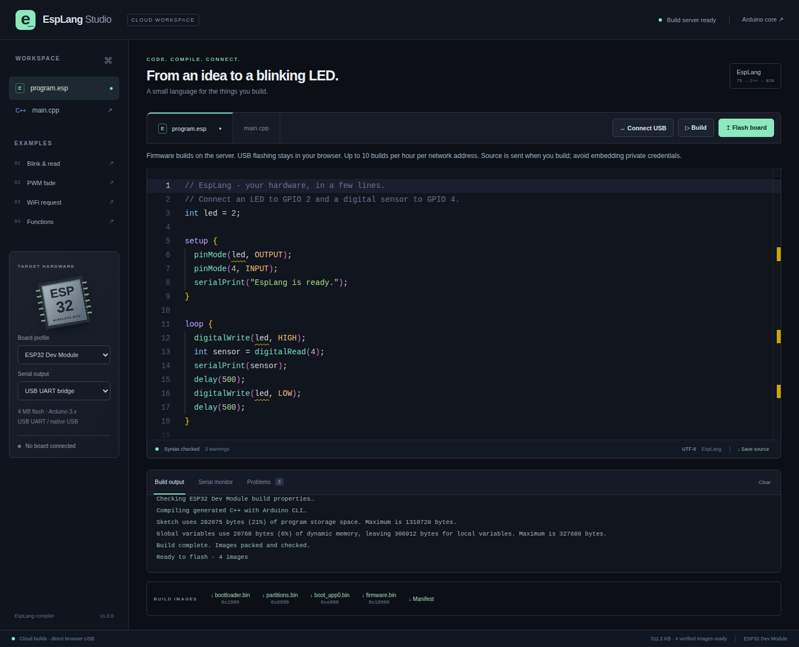
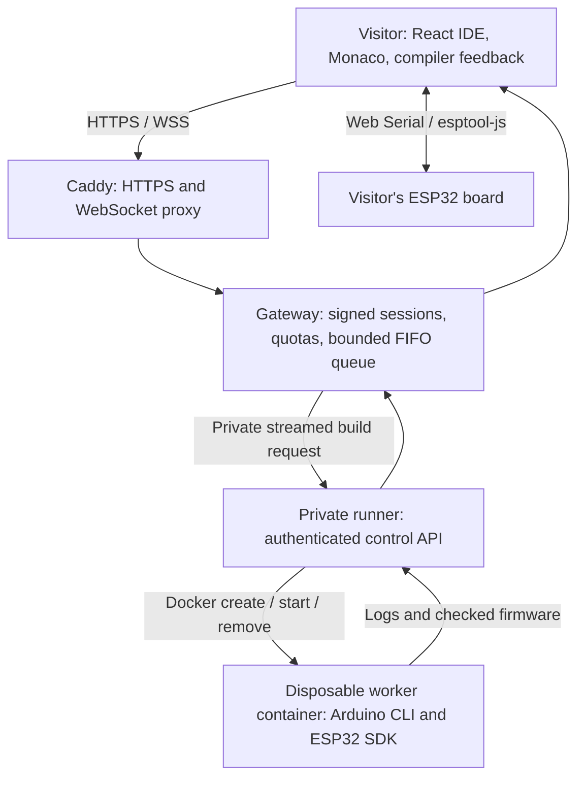

# Public hosted EspLang Studio

Visitors open your HTTPS website, write EspLang, submit a firmware build, then select their USB board in Chrome or Edge. They do not install Node.js, Arduino CLI, or the ESP32 SDK. Firmware compilation happens on your server; flashing and serial traffic stay between the visitor's browser and board.

This repository includes a deployment for **one Linux x86_64 server**. It implements an anonymous public beta with a bounded in-memory queue and quotas per client network address. It does not provision a cloud server or purchase a domain.



Captured from the [successful HTTPS deployment test](https://github.com/TharunBabu-05/EspLang_Studio/actions/runs/41470509617), using the bundled Blink example. No physical USB device was used in that test.

## Architecture



The gateway has no Docker socket, SDK, or host filesystem mount. Only the private runner can control Docker. Job containers receive source over stdin and return NDJSON over stdout; they receive no service secrets, host mounts, or network access. A fresh container and temporary filesystem are used for every job.

## Deploy

Prerequisites:

- A Linux x86_64 server with Docker Engine and Docker Compose v2, plus Git.
- A practical starting allocation of **4 vCPUs, 8 GB RAM, and 30 GB free disk** for two concurrent jobs, images, and installation downloads. This is a sizing starting point, not a load-test result.
- A domain or subdomain with DNS pointing directly to that server. Open inbound TCP 80/443 and optionally UDP 443.
- Permission for your administrator account to use Docker.

On the server:

```sh
git clone https://github.com/TharunBabu-05/EspLang_Studio.git
cd EspLang_Studio
sh deploy/start.sh studio.your-domain.com
```

Replace `studio.your-domain.com` with your actual hostname. The launcher generates unique secrets in ignored `deploy/.env`, builds the Linux SDK image, builds the gateway/runner, and starts Caddy and the services. Node.js is used inside Docker to generate configuration; it does not need to be installed on the host. The first SDK image build downloads several gigabytes and can take considerable time.

Open **`https://studio.your-domain.com`** after DNS resolves and Caddy obtains a certificate. Check the header says **CLOUD WORKSPACE** and **Build server ready**. Build an example, click **Connect USB**, choose your board, and flash it. The server does not need a physical ESP32.

Caddy obtains and renews HTTPS certificates and proxies WebSockets. See the [Caddy HTTPS documentation](https://caddyserver.com/docs/automatic-https) for DNS and firewall requirements.

## Default limits

| Control                                | Default                                             |
| -------------------------------------- | --------------------------------------------------- |
| Active builds                          | 2 globally                                          |
| Waiting builds                         | 20 globally                                         |
| Outstanding builds per network address | 1 queued or running                                 |
| Build allowance                        | 10 accepted attempts per network address per hour   |
| Maximum queue wait                     | 120 seconds                                         |
| Maximum build execution                | 240 seconds, plus bounded container startup/cleanup |
| Browser token lifetime                 | 30 minutes                                          |
| API requests                           | 120 per minute per network address                  |
| WebSocket handshakes                   | 30 per minute per network address                   |
| Simultaneous WebSockets                | 3 per address, 100 globally                         |
| Source / request                       | 100,000 source characters within a 128 KiB message  |
| Sandbox CPU                            | 1 CPU                                               |
| Sandbox RAM / swap                     | 2 GiB RAM; additional swap disabled                 |
| Sandbox writable temporary space       | 1 GiB tmpfs, counted against the RAM limit          |
| Sandbox process count                  | 128                                                 |

Accepted build attempts consume quota even if compilation fails or the user cancels. A full queue, duplicate outstanding request, or invalid session is rejected before charging build quota. Limits use fixed windows. Users sharing a public network address share its quota. Creating another browser token does not reset it.

Edit `deploy/.env` to adjust `BUILD_CONCURRENCY`, `BUILDS_PER_HOUR`, `MAX_QUEUED_BUILDS`, `BUILD_TIMEOUT_MS`, `QUEUE_TIMEOUT_MS`, `WORKER_MEMORY_MB`, `WORKER_TMPFS_MB`, or `WORKER_CPUS`. Recreate services afterward:

```sh
docker compose --env-file deploy/.env -f deploy/compose.yml up -d
```

Keep concurrency consistent between gateway and runner, and reserve enough host memory for every active worker plus the web services. Increasing tmpfs consumes the worker's memory budget. The kernel constraints follow [Docker's container resource and runtime controls](https://docs.docker.com/reference/cli/docker/container/run/).

## Isolation and operational boundaries

- Each worker runs as UID/GID `1000:1000`, with a read-only root filesystem, dropped capabilities, `no-new-privileges`, default Docker seccomp, and no network. The writable `/tmp` allows tool execution because the packaged native tooling may extract executables there.
- The runner is a **privileged control component** because Docker socket access grants control over the host. It has no published port and is separated from public ingress by a private Docker network. Do not expose port 3002 or the Docker socket. Use a dedicated host for this deployment.
- The Caddy ingress overwrites forwarding headers. The gateway trusts client addresses only from the configured edge subnet (`172.30.21.0/24`). If that subnet conflicts with your infrastructure, change both the Compose network and `TRUST_PROXY_CIDRS`. Adding another CDN/proxy requires deliberately configuring its trust boundary; arbitrary forwarding headers are not trusted.
- The site is anonymous. Signed tokens authorize a short-lived browser build session; they are not user accounts. Per-address quotas limit ordinary use but are not a replacement for account quotas or upstream abuse protection for a large public service.
- The queue and usage counters live in one gateway process. Restarting loses waiting jobs and resets quotas. Do not scale gateway replicas independently; a durable shared queue and shared quotas are needed for that architecture.
- Cancellation removes a queued job or aborts and removes its container. The runner holds its active slot through cleanup. A restarted runner removes leftover containers with its pool label before accepting work. The deployment assumes one runner owns that pool.
- Visitors' source is transmitted to the server only when building (or when explicitly calling the analyze API). It exists transiently in memory and the job's temporary filesystem. There is no application database, source archive, or completed-build store. The generated firmware returns to the requesting browser. Infrastructure administrators can access server memory and running containers; avoid embedding private credentials in public-service submissions.
- Docker container isolation shares the host kernel. Keep Docker and the host patched; use stronger VM isolation if your deployment requires that boundary.

## Operations

```sh
# Status and service logs; source text is not intentionally logged by the app.
docker compose --env-file deploy/.env -f deploy/compose.yml ps
docker compose --env-file deploy/.env -f deploy/compose.yml logs --tail 100 gateway runner caddy

# Update source, rebuild images, and recreate the services.
git pull --ff-only
sh deploy/start.sh studio.your-domain.com

# Stop services. Keep Caddy volumes so certificates survive a restart.
docker compose --env-file deploy/.env -f deploy/compose.yml down
```

Back up `deploy/.env` and the Caddy certificate volumes privately. Secret rotation invalidates browser tokens or runner authentication; recreate both gateway and runner together. Build images contain no deployment secrets. The image currently pins Arduino CLI 1.3.1 and Arduino-ESP32 3.3.2; base Node, Docker CLI, and Caddy images follow their selected major release lines.

## Verification

The normal test suite covers queue ordering and capacity, cancellation ownership, deadlines, signed-token tampering and expiry, quota persistence across fresh tokens, proxy-header trust, HTTP/WebSocket admission, fragmented worker streams, and sandbox launch constraints.

The **Hosted deployment** GitHub Actions workflow builds the actual Linux worker image and starts the deployment with a local test CA. It opens the HTTPS IDE in Chromium, performs a real native build, inspects the running container's network/user/memory/mount settings, verifies the returned image checksums, and checks container cleanup. The test CA and certificate-verification exception in `scripts/test-hosted.mjs` are exclusively for that CI stack; production uses Caddy's publicly trusted certificates.

To run that smoke test on a disposable Linux test host, use `studio.localhost` configuration, build the images, then run:

```sh
docker compose --env-file deploy/.env -f deploy/compose.yml -f deploy/compose.test.yml up --build -d
npm ci
npx playwright install chromium --with-deps
node scripts/test-hosted.mjs
```

The test binds ports 80/443 and requires the worker image to have been built first. It does not request USB access or test a physical board. Results and screenshots are written under ignored `.verification/hosted/`.
