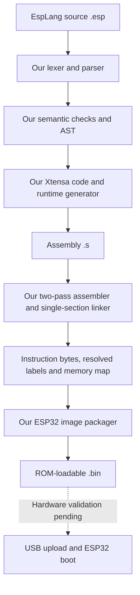

# EspLang Native v0.1: original ESP32

An experimental, repository-owned compiler and builder for **ESP32 / ESP32-WROOM-32
(Xtensa LX6)**. It emits assembly and a ROM-loadable firmware image directly from
EspLang. It does not invoke Arduino CLI, GCC, LLVM, an external assembler/linker,
or esptool, and includes no prebuilt Arduino/ESP-IDF libraries or vendor
second-stage bootloader.

**First hardware blink reported on November 7, 2026.** The supplied terminal log
confirms a verified upload to an ESP32-D0WD-V3; the user observed LED blinking after
upload/reset. This is evidence for the tested blink program, not qualification of
all native features or boards. Power-cycle persistence and measured timing remain
pending. The browser IDE's Build button continues to use Arduino; the native path
has a CLI and TypeScript API.

## Build

Install Node.js dependencies with `npm ci`. No `setup:toolchain` step is needed.

```powershell
npm.cmd run build:native -- examples/native-blink.esp
```

Use `npm` on Linux/macOS. An optional second argument changes the output directory.
This command writes files only; it does not flash a board.

Default output: `.builds/native/native-blink/`

| File               | Contents                                                                                 |
| ------------------ | ---------------------------------------------------------------------------------------- |
| `program.s`        | Xtensa assembly, literal pool and source-line annotations                                |
| `program.code.bin` | Linked instruction/literal bytes; **not a flash image**                                  |
| `program.bin`      | ROM image headers, code/data segments, padding and checksum                              |
| `program.map.json` | Entry, flash offset, symbols, variable locations, image SHA-256 and hardware assumptions |

The included blink example uses `pinMode(2, OUTPUT)`, `digitalWrite(2, HIGH/LOW)`
and `delay(500)`. It produces **464 code/pool bytes and a 1,536-byte firmware image**.
Entry point: `0x40080060`, after the literal pool.

## Pipeline and ownership



We reuse `lexer.ts`, `parser.ts`, `ast.ts` and `analyzer.ts`. Native generation is
in `packages/compiler/src/native/compiler.ts`, assembly/linking in
`native/assembler.ts`, packaging in `native/image.ts`, and the CLI in
`scripts/native-build.ts`.

The implementation language remains TypeScript. Node.js/TypeScript are host
dependencies; generated firmware has no JavaScript interpreter. The MCU's ISA,
registers, immutable ROM and boot-image format remain hardware contracts. We
implement those contracts rather than importing a firmware SDK.

```ts
import { compileNative } from '@esplang/compiler';
const result = compileNative(source, 'esp32');
// result.diagnostics includes source locations.
// On success, result.build contains assembly, image bytes and a memory map.
// Unsupported/invalid input yields no build and no Arduino fallback.
```

## Language subset

| Feature                                       | Native v0.1                                                   |
| --------------------------------------------- | ------------------------------------------------------------- |
| `setup`, `loop` / `task`, early `return`      | Setup once, loop repeats                                      |
| `int`, `bool`, globals, locals, nested scopes | Supported; 256 total variable/temporary slots                 |
| `+`, `-`, `*`, unary `+`/`-`                  | Signed 32-bit values with wrapping arithmetic                 |
| `==`, `!=`, `<`, `<=`, `>`, `>=`              | Supported, signed comparisons                                 |
| `!`, `&&`, `                                  |                                                               | `   | Supported; short-circuit evaluation |
| `if`/`else`, `while`, `for`                   | Supported                                                     |
| GPIO                                          | Constant `pinMode(2, OUTPUT)` and `digitalWrite(2, HIGH/LOW)` |
| Delay                                         | Constant integer 0..60000 ms; cycle-counter polling at 40 MHz |
| Functions, division, remainder, float, string | Explicit unsupported-feature errors                           |
| Serial, input GPIO, PWM, Wi-Fi, HTTP          | Explicit unsupported-feature errors                           |
| Other chip families                           | Rejected; original ESP32 only                                 |

The existing `examples/blink.esp` includes serial printing and GPIO input, which
this backend does not support yet. Use `examples/native-blink.esp`.

Source is limited to 64,000 characters; code/pool to 32 KiB. This first backend
uses fixed registers and static temporary slots rather than an optimizing IR,
general register allocator, function ABI, heap or general-purpose ELF linker.

## Runtime and memory layout

The image targets the original ESP32 ROM boot image location at **flash offset
`0x1000`**, replacing the usual second-stage bootloader. It is not an Arduino
application image for `0x10000` and must not use an Arduino partition manifest.
The ROM is expected to copy code/data into RAM and enter `_start`; the application
runs from RAM without flash XIP.

| Region                     | Address / size                                               |
| -------------------------- | ------------------------------------------------------------ |
| IRAM code/literal pool     | `0x40080000` through `0x40087fff`, maximum 32 KiB            |
| DRAM variables/temporaries | `0x3ffb0000`, 1 KiB, zero-filled by the image loader         |
| Reserved stack             | `0x3ffb7000` through `0x3ffb7fff`; initial `a1 = 0x3ffb8000` |
| Flash image                | Offset `0x1000`, DIO, 40 MHz, 4 MiB flash header             |

Startup masks normal interrupts, establishes stack/data base, keeps the second
core stalled, disables RTC/timer-group boot watchdogs, and selects the 40 MHz
crystal clock without division. GPIO 2 uses direct IO-mux and GPIO-matrix register
writes. Delays poll CCOUNT with unsigned elapsed-time subtraction to handle wrap;
loop overhead makes timing approximate.

Assumptions: standard ESP32-WROOM-32, **40 MHz crystal and 4 MiB flash**, cold ROM
flash boot, secure boot and flash encryption disabled. Deep-sleep resume,
interrupts, radio initialization, other wiring and chip revisions are not
qualified. GPIO 2 needs an LED attached; not every board has an onboard LED there.
GPIO 2 is also a boot-strapping pin.

Do not use the existing Arduino flashing manifest for this image. A test upload
would overwrite the installed bootloader at `0x1000`; select the exact board/port
and have a recovery image or original firmware backup before hardware validation.

## Validation and limits

- Tests cover instruction constants, literal addressing across PC alignments,
  control flow, operand/branch limits, and invalid/unsupported programs.
- Our original `tests/fixtures/xtensa-native-vectors.s` was independently assembled
  using Espressif GNU binutils with `--no-transform`. Its 103-byte `.hex` output
  is checked in; normal tests compare against it without requiring that tool.
- All 464 code/pool bytes of the blink program matched the independent assembler.
  This was a development check, not a build dependency.
- A test-only instruction decoder checks arithmetic, scopes, loops, GPIO write
  sequences and synthetic CCOUNT wrap. It does not emulate ROM or peripherals.
- Image tests independently check headers, bounds, alignment, segments, padding
  and checksum. An additional esptool 5.1.0 development check accepted the blink
  image and reported a valid checksum. Native builds never invoke esptool.
- CI is configured to run the native build without an installed ESP32 SDK.

Run `npm test` and `npm run typecheck`. The latest implementation check passed 150
tests, including 56 native compiler tests and 44 uploader/serial tests, plus type
checking and production builds. See [our ROM uploader](NATIVE_UPLOADER.md) for the
separate upload implementation and pending hardware acceptance.

## Hardware test record

On November 7, 2026, the user supplied esptool terminal output and reported that
the LED began blinking after the native image was uploaded.

| Check                            | Evidence / result                                                                 |
| -------------------------------- | --------------------------------------------------------------------------------- |
| Chip                             | ESP32-D0WD-V3, revision v3.1; original ESP32 family                               |
| Crystal / flash                  | 40 MHz / 4 MB, detected by esptool 5.1.0                                          |
| Connection                       | CP210x USB-UART bridge, COM13 in the test session                                 |
| Image                            | Native blink: 464 code/pool bytes, 1,536 image bytes, offset `0x1000`             |
| Upload                           | `--no-stub`; affected sector `0x1000..0x1fff`; hash verified; automatic RTS reset |
| Transfer length                  | Tool reported 2,048 bytes including transfer padding; image itself is 1,536 bytes |
| GPIO behavior                    | LED blinking after upload/reset, reported by user; no hardware video captured     |
| Recovery backup                  | Interrupted at 10.9% when RESET was pressed; not a verified full backup           |
| Power-cycle persistence / timing | Not yet reported / not instrumented                                               |

The original interrupted backup must not be used for full restoration. A new
backup taken after flashing contains the native firmware, not the complete prior
image. See the README's [identify, backup and flash instructions](../README.md#identify-back-up-and-flash)
for guarded commands and recovery guidance. Device MAC addresses and raw firmware
backups are intentionally excluded from the published record.

Remaining acceptance work: cold power cycling, measured timing and broader
feature/board qualification. The CLI's generated `hardwareVerified: false` field
is conservative per-build metadata; compiling a new program does not establish
that it has been tested on a physical board.

## Next steps

1. Confirm power-cycle persistence and measure timing after the initial reported blink.
2. Continue hardware validation of [our ROM uploader](NATIVE_UPLOADER.md): manual
   identification passed; verified backup, explicit write, power-cycle and restore
   remain. Automatic ROM entry still needs work on the tested Windows/CP210x board.
3. Expand GPIO coverage, UART output, input handling and timers.
4. Add an IDE native-backend selector, assembly view and compatible flash manifest
   after hardware validation.
5. Add function calls, more operators/types, optimizing IR and other CPU targets.
   Networking needs separate driver/protocol work.

## References

- [Espressif Xtensa ISA reference](https://github.com/espressif/xtensa-isa-doc)
- [ESP32 technical reference manual](https://www.espressif.com/sites/default/files/documentation/esp32_technical_reference_manual_en.pdf)
- [ESP32 datasheet](https://documentation.espressif.com/esp32_datasheet_en.html)
- [ESP32 image format](https://docs.espressif.com/projects/esptool/en/latest/esp32/advanced-topics/firmware-image-format.html)
- [ESP32 ROM serial protocol](https://docs.espressif.com/projects/esptool/en/latest/esp32/advanced-topics/serial-protocol.html)

Register addresses/fields were cross-checked against ESP32 SoC definitions. No SDK
implementation or runtime binary is linked into the firmware. Use references for
the original ESP32, not the similarly named S2, S3, C3 or C6.
